*This project has been created as part of the 42 curriculum.*

<div align="center">

# NULL//CITY

### S I G N A L &nbsp; L O S T

**An atmospheric cyberpunk RPG, hands-on cybersecurity simulator, and multiplayer learning arena.**

`FT_TRANSCENDENCE` · `WEB APPLICATION` · `CYBERSECURITY` · `MULTIPLAYER` · `PIXEL ART`

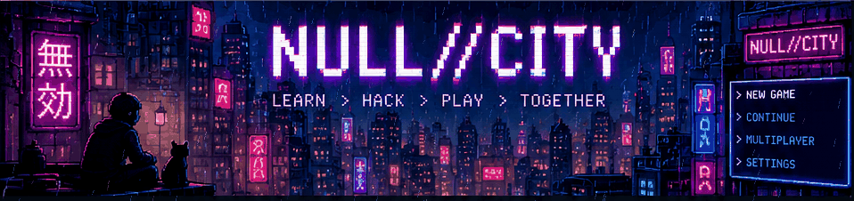

*The city remembers everything. Even the things someone tried to erase.*

[Explore the city](#description) · [Run the project](#instructions) · [Architecture](#technical-stack-and-architecture) · [Modules](#ft_transcendence-modules) · [Evaluation status](#evaluation-status-and-known-limitations)

</div>

---

## Description

**NULL//CITY: SIGNAL LOST** is a browser-based 2D cyberpunk role-playing game built around practical cybersecurity concepts. Players move through a rain-soaked pixel city, investigate a person erased from its registry, interact with characters, and solve simulated technical incidents through an in-game terminal.

The project combines two complementary experiences:

1. **Story mode:** an explorable, top-down city with missions, dialogue, a branching campaign, character customization, saved progress, and an isolated network/file-system simulator. Terminal commands change a *fictional model*; they do not attack real machines or external hosts.
2. **Network club:** an authenticated multiplayer space with profiles, friends, public chat, live quiz matches for **2–4 players**, spectators, match history, achievements, XP, and leaderboards.

The objective is to make abstract security concepts approachable through discovery and decisions, while demonstrating the frontend, backend, persistent database, user management, and concurrent multiplayer features required for **42 ft_transcendence v21.2**.

### At a glance

| Experience | Highlights |
|:--|:--|
| **Investigate** | Eleven linked cases in two story chapters: routing, DNS, file evidence, firewall rules, recovery, phishing and responsible reporting |
| **Explore** | Walkable city districts and interiors, reactive NPCs, quests, city map, journals and ambient weather |
| **Experiment** | Stateful virtual terminal with modeled network conditions and reproducible safe failures |
| **Personalize** | Editable character appearance, seven hairstyles, colors and outfit purchases with persistent progression |
| **Compete** | Two-to-four-player, five-round quiz matches, custom room settings, spectator mode, reconnectable sessions |
| **Connect** | Email/password accounts, profiles, avatars, friends, presence and public messages |
| **Progress** | Persistent server-derived match results, XP, levels, badges, leaderboard and daily learning rewards |

### Screenshots and visual tour

The gallery combines the **current menu background artwork** and screenshots included in the game's `docs/` folder. Screenshots document the game's recorded interfaces (some from the earlier 1.0 release). Everything is stored locally in this repository; no third-party image host is required.

#### 01 / The new menu atmosphere

<p align="center">
  
</p>

*Current menu background artwork. Interactive buttons and text are rendered by the game, not embedded in this image.*

#### 02 / Main-menu screenshot (release 1.0)

<p align="center">
  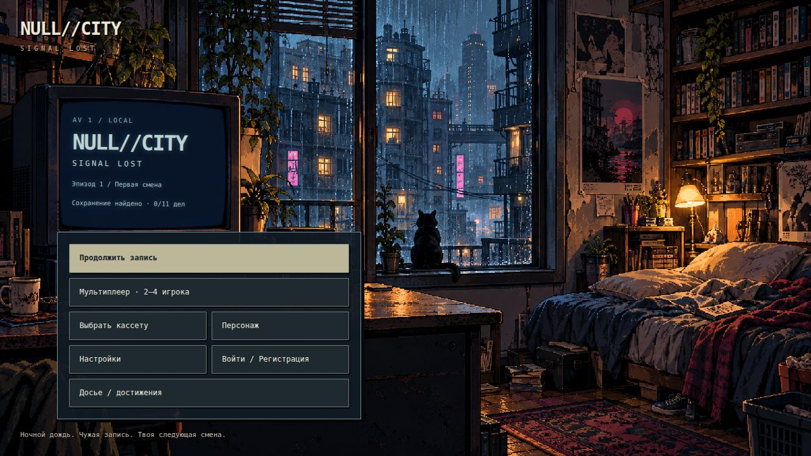
</p>

#### 03 / Explore the city · hack the simulation

| Top-down cyberpunk city | In-game cybersecurity terminal |
|:--:|:--:|
| 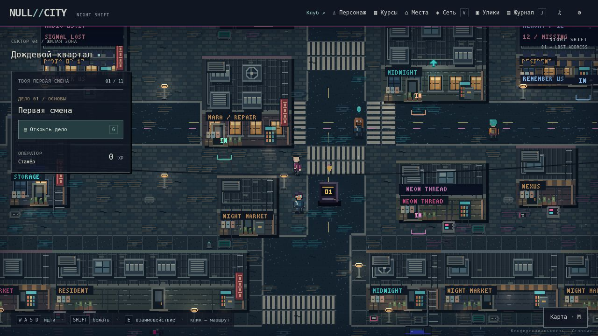 | 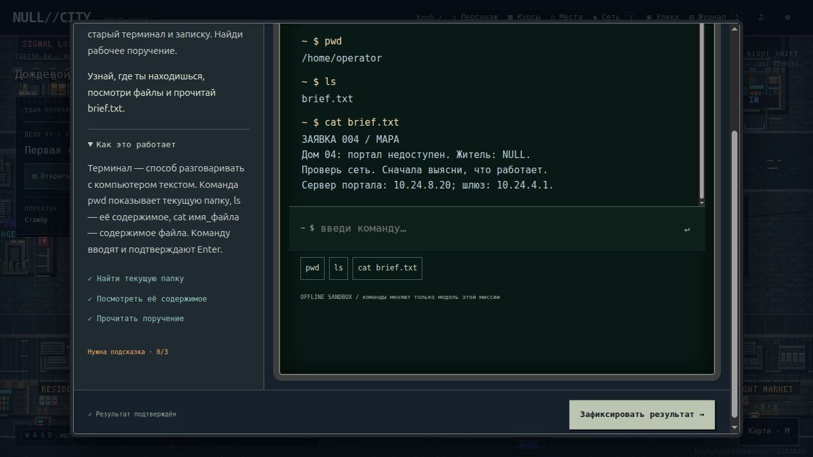 |

#### 04 / Make the story your own

| Character customization | Mission dossier and progression |
|:--:|:--:|
| 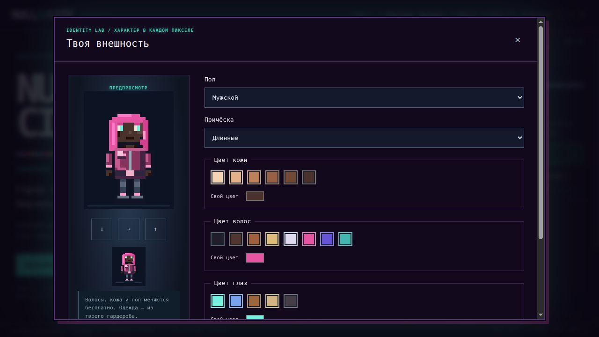 | 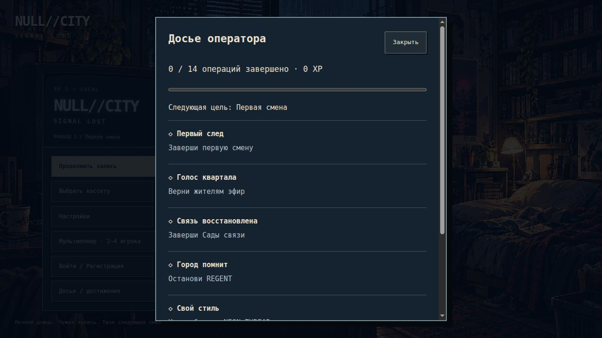 |

#### 05 / Districts and activities

| Capital city district map | NEON THREAD clothing store |
|:--:|:--:|
| 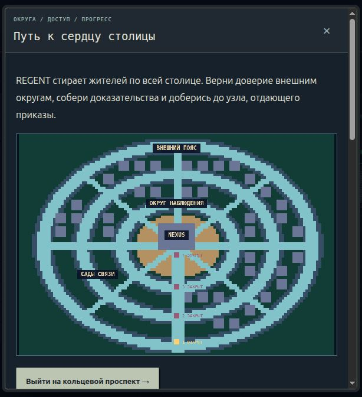 | 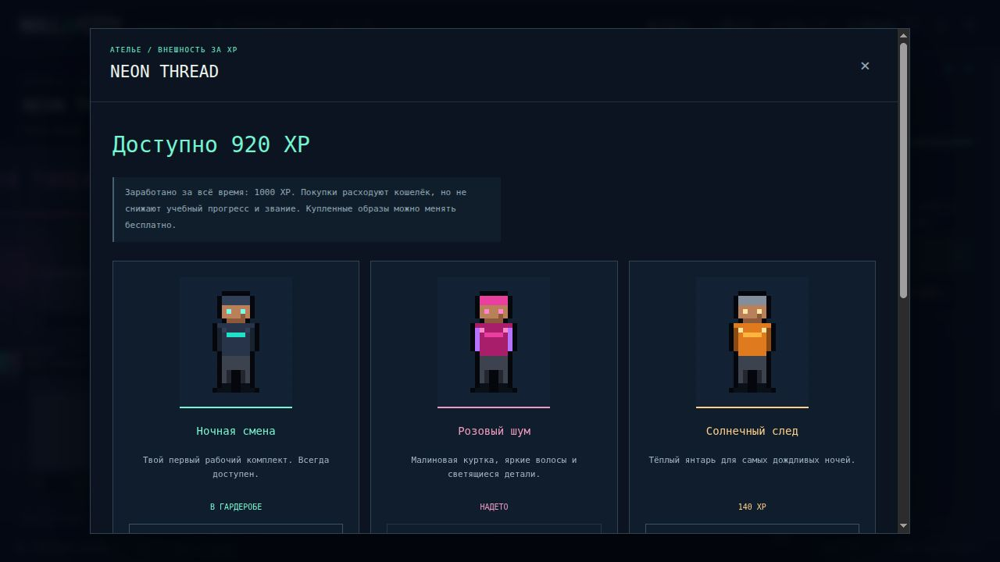 |

#### 06 / Mobile interface

<p align="center">
  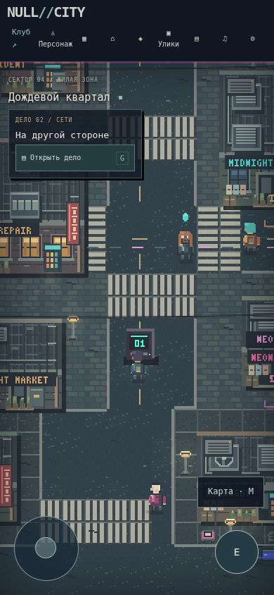
</p>

> Images document screens in the supplied archive; they are not evidence of independently verified multiplayer, deployment or module completion.

More visual and implementation notes: [SIGNAL LOST](docs/SIGNAL-LOST.md) · [Capital districts](docs/CAPITAL.md) · [Release notes](docs/RELEASE-1.0.md).

---

## Instructions

### Prerequisites

- **Docker Engine** and the **Docker Compose v2** plugin (recommended: required deployment method for evaluation).
- A recent **Google Chrome** installation.
- Access to download packages when the Docker image is first built.
- **Optional for source tests/build:** Node.js 20+ and npm.
- **Optional for native HTTPS fallback and its tests:** Python 3.12+, Pillow and OpenSSL.

### 1. Clone and configure

```bash
git clone https://github.com/YOUR_ACCOUNT/YOUR_REPO.git null-city
cd null-city
cp .env.example .env
```

Replace `YOUR_ACCOUNT/YOUR_REPO` with your team's actual GitHub repository path. Inspect `.env.example` before editing `.env`.

| Environment setting | Default | Meaning |
|:--|:--|:--|
| `PUBLIC_ORIGIN` | `https://localhost:8443` | Browser-visible HTTPS origin; must match the actual external origin |
| `PORT` | `8443` | Port published on the host's loopback interface |
| `DATABASE_PATH` | `/app/data/nullcity.sqlite3` in Compose | SQLite database file in the persistent Docker volume |
| `TLS_CERT`, `TLS_KEY` | Created on first launch | Native launcher certificate/key path overrides |

Never commit `.env`, session secrets, real databases, or private TLS keys. These paths are ignored by `.gitignore` in the supplied project.

### 2. Start the complete application (recommended)

```bash
docker compose up --build -d
```

Open **https://localhost:8443/** to access the city, accounts, and network club. From the main menu choose **Sign in / Register** to create an account, or **Multiplayer** to enter the club.

The container creates a local **self-signed TLS certificate** on first launch. Browsers do not trust it automatically: establish trust using an approved local certificate setup or deploy a trusted certificate for the real hostname. **Do not disable TLS verification.** The default listener is bound to `127.0.0.1`, so it is not automatically accessible from another computer.

```bash
# Operational checks
docker compose ps
docker compose logs --tail=50

# Stop without deleting the database volume
docker compose down
```

For an evaluation on separate devices, configure a trusted HTTPS origin, set `PUBLIC_ORIGIN` accordingly, and expose the service deliberately through an appropriate secure deployment/reverse proxy. A single-host demo is not proof of remote play.

### 3. Native HTTPS fallback (development only)

When Docker execution is unavailable:

```bash
python3 scripts/serve.py
# Equivalent project shortcut: npm run dev
```

This starts the same Python HTTPS application, using the local `.env` configuration and SQLite data. Install Pillow and OpenSSL in the native environment first. The fallback **does not replace** the mandatory single-command container deployment requirement.

### 4. Standalone single-player preview

```bash
npm run preview:static
```

Visit **http://127.0.0.1:4173/** or open the generated `NULL-CITY.html` offline. This mode demonstrates the story; it **does not** provide the HTTPS-backed account system, online matchmaking or persistent server-side statistics.

```bash
npm run build    # Rebuild the standalone NULL-CITY.html
```

### Controls

| Control | Action |
|:--|:--|
| `WASD` / arrow keys | Move |
| `Shift` | Run |
| `E` | Interact |
| `G` | Navigate to the current case |
| `V` | Network vision |
| `M` | City map |
| `I` | Inventory |
| `J` | Journal |
| `Esc` | Close dialogs |
| Mouse / touch | Select destinations and use the mobile interface |

### Tests and checks

```bash
npm run check        # JavaScript syntax + Python compilation
npm test             # Node.js frontend / game-model tests
npm run test:server  # Isolated HTTPS backend integration tests
npm run build        # Rebuild the standalone edition
```

**Verification with the supplied archive (18 October 2026):** 53 Node.js tests and 8 Python HTTPS integration tests passed in the inspection environment. These results do **not** establish production readiness, latest-Chrome compliance, accessible UI behavior, or successful Docker runtime execution on your evaluation machine.

### Backups

The Compose deployment keeps its SQLite database in the `city-data` volume. To create a consistent database backup:

```bash
docker compose exec nullcity python3 server/backup.py /app/data/nullcity.sqlite3 /app/data/backup.sqlite3
docker compose cp nullcity:/app/data/backup.sqlite3 ./backup.sqlite3
```

Use a fresh output path for each backup. Restores must be performed with the server stopped, retaining a copy of the current database and checking the restored data before restarting. Automated backup scheduling is not claimed.

---

## Technical Stack and Architecture

| Layer | Technology | Rationale |
|:--|:--|:--|
| Frontend | HTML5, modern **vanilla JavaScript / ES modules** | Explicit, inspectable game state and UI without a heavyweight framework |
| Graphics | Canvas 2D, original/pixel-art atlases and native CSS | Precise sprite rendering, world navigation and thematic presentation |
| Backend | **Python**, `ThreadingHTTPServer`, standard-library HTTP and SSL | Small, reviewable HTTPS API and server-authoritative game rules |
| Database | **SQLite**, relational schema, foreign keys and WAL | Lightweight persistent data with transactional multiplayer decisions |
| Authentication | Email/password, salted `scrypt` hashes, opaque session cookies | Passwords and session tokens are never stored as plaintext credentials |
| Realtime | Server-Sent Events (SSE) and match snapshot polling | Social/lobby invalidation and recoverable multiplayer state |
| Asset validation | Pillow | Decode, validate and re-encode uploaded PNG/JPEG avatars |
| Deployment | Docker, Docker Compose, HTTPS/TLS | Reproducible startup, isolated service, persistent volume |
| Tooling | npm scripts, Node test runner, Python `unittest` | Source checks, game-model and API regression tests |

**Framework declaration:** the project does **not** use React/Vue, Express/Django, an ORM or a JavaScript framework. Accordingly, no frontend/backend framework or ORM module points are claimed.

### System overview

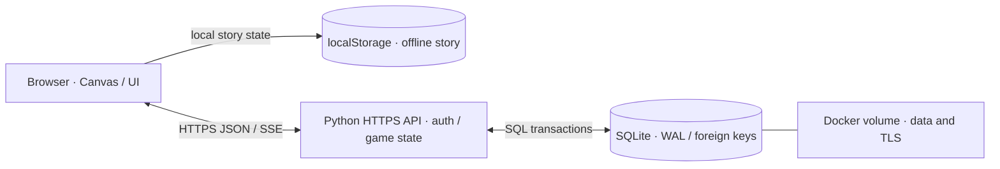

The **server** is authoritative for room membership, ready state, rounds, scores, hints and daily rewards. Every participant receives the same quiz deck; state-changing operations are transactional. Standalone story commands operate only on simulated files and network data.

**Security boundaries:** HTTPS-only API access, `Secure`/`HttpOnly`/`SameSite=Strict` session cookie, same-origin mutation checks, per-request input validation, parameterized SQL, rate limits, and atomic match decisions. This educational single-process deployment is **not** a substitute for a full production security audit.

### Important project paths

```text
null-city/
├── index.html                  # Main frontend entry point
├── hub.html                    # Online club interface
├── privacy.html                # Privacy Policy
├── terms.html                  # Terms of Service
├── src/                        # Canvas engine, story, UI, assets and client logic
├── assets/                     # Game graphics and sprites
├── server/
│   ├── app.py                  # HTTPS server, authentication, multiplayer API
│   ├── schema.sql              # Relational database schema
│   ├── questions.json          # Multiplayer question bank
│   └── backup.py               # SQLite backup utility
├── deploy/entrypoint.sh        # Container TLS bootstrap
├── tests/                      # Node and Python tests
├── docs/                       # Feature, API and evaluation documentation
├── scripts/                    # Standalone build and native server launcher
├── compose.yaml                # One-command container deployment
├── Dockerfile
├── .env.example
└── README.md
```

---

## Database Schema

The canonical schema is [`server/schema.sql`](server/schema.sql). Runtime migrations in `server/app.py` add `players.ready` and `rooms.rematch_of` without discarding existing data.

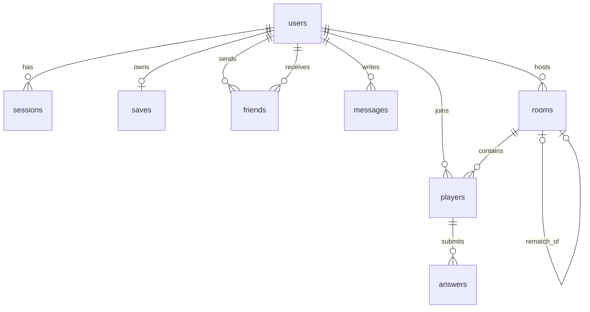

| Table | Key fields and types | Purpose / constraints |
|:--|:--|:--|
| `users` | `id INTEGER PK`, `email TEXT UNIQUE`, `password TEXT`, `name TEXT`, `bio TEXT`, `avatar BLOB`, `created INTEGER`, `seen INTEGER` | Identity, salted password hash, profile and presence |
| `sessions` | `token TEXT PK`, `user_id INTEGER FK`, `expires INTEGER` | Hashed opaque sessions; cascade delete with user |
| `saves` | `user_id INTEGER PK/FK`, `payload TEXT`, `revision INTEGER`, `updated INTEGER` | One optional cloud save per user; revision-based conflict detection |
| `friends` | `sender INTEGER FK`, `recipient INTEGER FK`, `accepted INTEGER` | Friend requests; composite primary key and no self-links |
| `messages` | `id INTEGER PK`, `user_id INTEGER FK`, `body TEXT`, `created INTEGER` | Persisted public chat with body-length constraint |
| `rooms` | `id INTEGER PK`, `host INTEGER FK`, `capacity INTEGER`, `topic TEXT`, `duration INTEGER`, `state TEXT`, `round INTEGER`, `deadline INTEGER`, `deck TEXT`, `rematch_of INTEGER FK` | Multiplayer lobby, round state and shared rematch |
| `players` | `room_id INTEGER FK`, `user_id INTEGER FK`, `score INTEGER`, `hint_round INTEGER`, `hint_option INTEGER`, `ready INTEGER` | Room participation, server-owned score and readiness |
| `answers` | `room_id INTEGER`, `user_id INTEGER`, `round INTEGER`, `choice INTEGER`, `correct INTEGER` | One answer per participant per round; composite FK to `players` |

SQLite foreign keys and explicit transactions protect related state. Match updates use atomic database operations; outdated cloud-save revisions are rejected rather than silently overwriting another browser's changes. See [API documentation](docs/API.md).

---

## Features List

The following features are present in the supplied codebase. **Human owner fields must be completed by the real team.**

| Feature | Implementation / files | Responsible 42 login(s) |
|:--|:--|:--|
| Top-down city exploration and movement | `src/engine.js`, `src/art.js`, `src/places.js` | `TBD` |
| 2D graphics, building sprites and world assets | `src/building-assets.js`, `src/terrain-assets.js`, `src/city-meta*.js` | `TBD` |
| Story progression, dialogues and missions | `src/campaign.js`, `src/app.js` | `TBD` |
| Stateful security-simulation terminal | `src/simulator.mjs`, `src/signal-ui.js` | `TBD` |
| Character appearance, walk cycles and clothing | `src/characters.js`, `src/walkcycle-assets.js` | `TBD` |
| Retro television menu, visual settings and weather | `src/menu.js`, `src/opening-cover.js`, `src/style.css` | `TBD` |
| Registration, profiles, sessions and saves | `server/app.py`, `server/schema.sql` | `TBD` |
| Friends, chat, online presence and user search | `server/app.py`, `src/hub.js` | `TBD` |
| 2–4-player quiz, matchmaking, spectators, rematches | `server/app.py`, `src/hub.js`, `server/questions.json` | `TBD` |
| Statistics, XP, achievements and leaderboards | `server/app.py`, `src/hub.js` | `TBD` |
| HTTPS deployment, privacy/terms and backups | `Dockerfile`, `compose.yaml`, `deploy/`, `server/backup.py` | `TBD` |
| Automated checks and documentation | `tests/`, `docs/`, `scripts/` | `TBD` |

---

## ft_transcendence Modules

**Subject:** ft_transcendence **v21.2**. Major module = **2 points**; minor module = **1 point**; at least **14 validated points** are needed. The list below is a **candidate route**, not an awarded score. A module only counts when every required behavior can be demonstrated during peer evaluation.

| Category | Candidate module | Type | Points | Where / how | Owner(s) |
|:--|:--|:--:|--:|:--|:--|
| Web | Real-time features | Major | 2 | SSE updates for social/lobby data and reconnecting clients; `server/app.py` / `src/hub.js` | `TBD` |
| Web | User interaction | Major | 2 | Profiles, friend requests/list and public chat; `server/app.py` / `src/hub.js` | `TBD` |
| Web | Advanced search | Minor | 1 | Name query, online filter, sorting and pagination; `/api/users` | `TBD` |
| User Management | Standard user management | Major | 2 | Profile editing, avatar/default image, friends and presence | `TBD` |
| User Management | Game statistics and match history | Minor | 1 | Recorded match results, XP/levels, achievements and leaderboard | `TBD` |
| Gaming | Complete web-based competitive game | Major | 2 | Five-round scored multiplayer quiz with explicit winner/tie result | `TBD` |
| Gaming | Remote players | Major | 2 | Server-hosted room, shared match state, snapshots and reconnection | `TBD` |
| Gaming | Multiplayer game (3+ players) | Major | 2 | Up to four participants with shared rounds and atomic results | `TBD` |
| Gaming | Game customization | Minor | 1 | Topic selection, round timer and one-use Impulse hint | `TBD` |
| Gaming | Gamification | Minor | 1 | Persistent XP/levels, badges and leaderboard with visual progress | `TBD` |
| Gaming | Spectator mode | Minor | 1 | Read-only access to running matches with live-state updates | `TBD` |
| Modules of choice | Stateful cybersecurity incident simulator | **Major candidate** | 2 | `src/simulator.mjs`: causal network/file/firewall model and linked challenges | `TBD` |
| | **Total candidate points** | | **19** | **14 needed; acceptance subject to evaluation** | |

### Custom major: stateful incident simulator — justification

**Why this module?** Cybersecurity learning is more meaningful when a command changes a system's behavior, not just when the player picks an answer from a preset list.

**Technical challenge.** The project models a bounded virtual network and file environment with mutable DNS, routes, firewall rules, evidence and recovery state. Later tasks depend on earlier changes; incorrect operations can create new failures that must be diagnosed and reversed. Progress and causal state are serialized without giving the browser access to real targets.

**Value to users.** Players can investigate mistakes, observe consequences and practice evidence-based problem solving in a safe environment that complements multiplayer quizzes.

**Why Major rather than Minor?** This is a reusable state-transition system with multiple dependent tasks and validations, not an isolated UI feature. **Its classification as a two-point custom module remains subject to the evaluator's approval.** See the detailed [evaluation matrix](docs/EVALUATION.md).

### Module dependencies and evaluation boundaries

- The **game statistics**, **customization**, **spectator**, and multiplayer modules depend on the functioning quiz game.
- **User interaction** must satisfy the subject's chat requirements; whether the current *public channel* meets evaluators' expectations for messages *between users* should be explicitly checked.
- **Remote players** still require a practical demonstration from independent devices and a correctly trusted HTTPS connection.
- The project does **not** claim framework, ORM, OAuth, WCAG 2.1 AA, multilingual, WAF/Vault, production GDPR compliance, or other unimplemented modules.
- These **19 points** are potential only: incomplete, rejected or undemonstrated modules count for **0**.

---

## Team Information

The subject requires **4–5 real students**, with a Product Owner, Project Manager / Scrum Master, Technical Lead / Architect and developers. Every member contributes to implementation, review, testing and documentation. Multiple roles may be assigned to one person.

| Actual 42 login | Assigned role(s) | Specific responsibilities |
|:--|:--|:--|
| `LOGIN_1` | `TBD — e.g., Product Owner + Developer` | `TBD — actual features, backlog and acceptance decisions` |
| `LOGIN_2` | `TBD — e.g., Project Manager + Developer` | `TBD — actual task coordination, schedule and delivered code` |
| `LOGIN_3` | `TBD — e.g., Technical Lead + Developer` | `TBD — actual architecture, review and implementation` |
| `LOGIN_4` | `TBD — Developer` | `TBD — actual features, testing and documentation` |
| `LOGIN_5` *(if applicable)* | `TBD` | `TBD` |

> This table is a **fillable template**, not a claim about who performed the work. Delete the optional fifth row if the team has four people.

## Project Management

**Artifacts available in the repository:** [`docs/ROADMAP.md`](docs/ROADMAP.md), [`docs/EVALUATION.md`](docs/EVALUATION.md), [`docs/VERIFICATION.md`](docs/VERIFICATION.md), tests and architecture documentation.

**Team-specific records — complete before submission:**

| Subject requirement | Actual team practice and evidence |
|:--|:--|
| Work planning / breakdown | `TBD — how features were split and who owned them` |
| Project management tool | `TBD — actual GitHub Issues / Trello / other system, with link if available` |
| Meetings and checkpoints | `TBD — real cadence, planning sessions and decisions` |
| Communication | `TBD — real team channel (Discord, Slack, etc.)` |
| Code reviews | `TBD — how changes were reviewed and by whom` |
| Git history | `TBD — real commits and branches from each 42 team member` |

Do not invent meeting notes, issue history or commits. During the defense, each team member must be able to explain the architecture and their own work.

## Individual Contributions

Replace the template below with concrete contributions supported by the repository and your real collaboration history:

| Team member | Features / files implemented | Tests / reviews / documentation | Challenge overcome |
|:--|:--|:--|:--|
| `LOGIN_1` | `TBD` | `TBD` | `TBD` |
| `LOGIN_2` | `TBD` | `TBD` | `TBD` |
| `LOGIN_3` | `TBD` | `TBD` | `TBD` |
| `LOGIN_4` | `TBD` | `TBD` | `TBD` |
| `LOGIN_5` *(if applicable)* | `TBD` | `TBD` | `TBD` |

---

## Resources

### Documentation and references

- **42 ft_transcendence subject, v21.2** — mandatory web-app requirements, role assignment, README and module evaluation rules (course document).
- [MDN — Canvas API](https://developer.mozilla.org/en-US/docs/Web/API/Canvas_API) — 2D browser rendering and interaction.
- [MDN — Server-Sent Events](https://developer.mozilla.org/en-US/docs/Web/API/Server-sent_events) — live browser updates via EventSource.
- [Python — `http.server`](https://docs.python.org/3/library/http.server.html) — HTTP server foundation.
- [Python — `sqlite3`](https://docs.python.org/3/library/sqlite3.html) — database API and transactional operations.
- [SQLite — WAL](https://www.sqlite.org/wal.html) — journal behavior and concurrent reads.
- [Docker — Compose documentation](https://docs.docker.com/compose/) — build, deploy and volume management.
- [OWASP — Password Storage Cheat Sheet](https://cheatsheetseries.owasp.org/cheatsheets/Password_Storage_Cheat_Sheet.html) — salting and password hashing.
- [OWASP — CSRF Prevention Cheat Sheet](https://cheatsheetseries.owasp.org/cheatsheets/Cross-Site_Request_Forgery_Prevention_Cheat_Sheet.html) — same-origin request protection.
- [CompTIA Security+](https://www.comptia.org/en-us/certifications/security/) and [OffSec PEN-200](https://www.offsec.com/courses/pen-200/) — context for security topics; **the game is not an official certification course**.

### AI assistance disclosure

AI-assisted tools were used in the project workflow for **requirements analysis, planning, prototype and UI/code generation, visual iteration, test ideas and implementation, documentation and subject-to-code mapping**, including the creation/refinement of this README. These statements describe **AI assistance**, not the human contribution of any particular student. Before submission the team must verify exactly which changes it made, review generated code, test it independently, understand the implementation, and be able to explain or modify it during evaluation.

---

## Evaluation Status and Known Limitations

**Automated checks passed on the inspected copy**, but this README does not claim full compliance or an awarded grade.

- **Docker runtime validation:** project notes report that a previous host could build the image but failed to execute the container (`operation not permitted`). Retest `docker compose up --build -d` on the actual evaluation machine.
- **HTTPS trust and remote testing:** local self-signed TLS is not automatically browser-trusted; an independently verified multi-device multiplayer walkthrough is still necessary.
- **Browser and accessibility:** complete newest-Chrome console checks, responsive cross-device QA and assistive-technology review are not established by the automated test suite.
- **Content scope:** the main story includes the available case sequence; OSCP/Security+ course routes are introductory outlines, not finished certification curricula.
- **Backend scope:** single-process Python and SQLite are suitable for the present learning/demo setup; no distributed deployment, formal penetration-test audit, email verification/recovery, 2FA, moderation console, or automatic account deletion is claimed.
- **Compliance and privacy:** Privacy Policy and Terms pages exist (`privacy.html`, `terms.html`); an accountable operator/contact and retention policy must be finalized before opening the application publicly.
- **Team evidence:** real logins, roles, feature ownership, collaborative history, and peer-review evidence are still required before 42 submission.

For reproducible test evidence, demonstration scenarios and module boundaries, see [docs/EVALUATION.md](docs/EVALUATION.md), [docs/VERIFICATION.md](docs/VERIFICATION.md), and [docs/API.md](docs/API.md).

---

<div align="center">


**NULL//CITY — SIGNAL LOST**

*Learn the system. Follow the signal. Find what was erased.*

</div>
